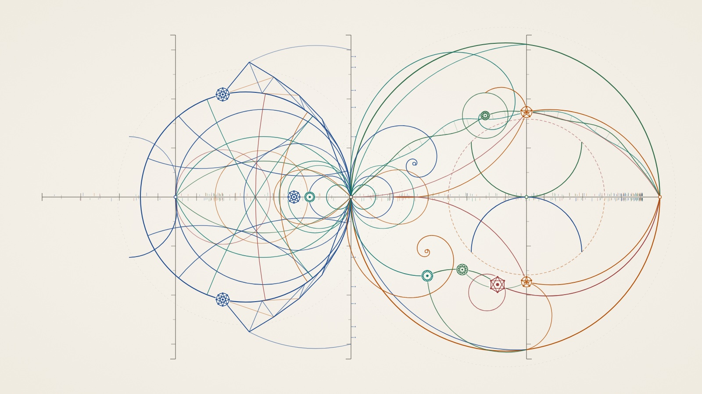

# The Novum Index

**An open-source interactive index tracking, verifying, and visualizing the exponential rise of AI-assisted and AI-led breakthroughs across Mathematics, Computer Science, Physics, Biology, and Chemistry/Materials.**

> Named after *novum* (Latin for *"the genuinely new thing"*, honoring Francis Bacon’s 1620 *Novum Organum* as AI becomes science’s new instrument), **The Novum Index** exclusively tracks AI-assisted and AI-led discoveries—separating machine-verified theorems and peer-reviewed landmarks from early preprints and contested claims posted directly to GitHub, arXiv, and X.



## Features

- **AI-Only Impact, Paradigm & Chronological Tracker**: Curates 70 AI-assisted and autonomous AI breakthroughs across 5 core disciplines and 50 years (1976–2026)—contrasting 5 pre-2020 symbolic AI pioneers (Meta-DENDRAL 1976, Graffiti 1986, Robbins Conjecture 1996, Robot Scientist Adam 2009, Boolean Pythagorean Triples 2016) and 8 early neural anchors (2020–2023, starting with Halicin and AlphaFold 2) against 57 breakthroughs from the 2024–2026 neural and neuro-symbolic wave.
- **Interactive Rubric Weight Tuner**: Adjust the four scoring weights live (or try presets like *Strict Formalists*, *Real-World Ripple*, or *AI Inflection*) and copy a shareable URL encoding your exact custom ranking.
- **Explicit Verification Tiers & Early Open-Internet Tracking**: Every milestone is labeled `Formally Verified`, `Peer-Reviewed`, `Preprint / Active Review`, or `Contested / Partial` alongside candid caveats—capturing both *Nature* landmarks and newly posted X/GitHub/Lean discoveries (such as the Lean-verified disproof of the Caiolo–Ferroni–Hoster conjecture).
- **Interactive Data Visualizations**:
  - **AI Impact × Time Landscape**: Interactive scatter map with drag-to-box-zoom, pan mode, time zoom presets (including `Q4 2026`), `Split` vs. `Linear` time axis, selectable Y-axis metrics, `Auto` vs. `0–100` Y-scaling, live crosshairs, and legend highlighting.
  - **AI Scientific Acceleration & Paradigm Shift Curve**: Stacked bars + cumulative growth curve with switchable cadence (`Era + Qtr`, `Annual`, `2024–26 Qtr`, `2026 Monthly`), `Linear` vs. `Log` scale, cumulative metric toggles (`Count`, `Human Yrs`, `Impact Sum`), and rich column tooltips.
  - **AI-for-Science Catalyst Network**: 5-column chronological DAG with smooth pan & zoom, `Full Chain` vs. `1-Hop` transitive lineage highlighting, and floating node previews.
- **Deep-Dive Breakthrough Dossiers**: Click any entry for plain-English + technical summaries, written rationale for every sub-score, lineage navigation, primary source links (including arXiv, Lean repos, and X announcements), and direct `#breakthrough/<id>` share links.
- **Editorial Craft**: Archival warm-paper light theme + obsidian dark mode (defaulting to OS theme preference), responsive layout, zero heavy framework dependencies.

## Quick Start

```bash
npm install
npm run validate   # Validates data/breakthroughs.json against the schema & lineage graph
npm run dev        # Starts local Vite dev server
npm run build      # Builds static production bundle to dist/
```

## Contributing a Breakthrough or Challenging a Score

This project is open source and designed for community curation:

- **No coding required**: Open a [Submit a Breakthrough](../../issues/new?template=submit-breakthrough.yml) or [Challenge a Score / Verification Status](../../issues/new?template=challenge-score.yml) issue.
- **Pull requests**: Edit [`data/breakthroughs.json`](./data/breakthroughs.json), run `npm run validate`, and open a PR. See [CONTRIBUTING.md](./CONTRIBUTING.md) and [METHODOLOGY.md](./METHODOLOGY.md) for full guidelines.

## Deploying to GitHub Pages

This repository includes `.github/workflows/deploy.yml`. Once pushed to GitHub, enable **Settings → Pages → Source: GitHub Actions**, and every push to `main` automatically validates the dataset and publishes the live site.

## License

[MIT](./LICENSE)
